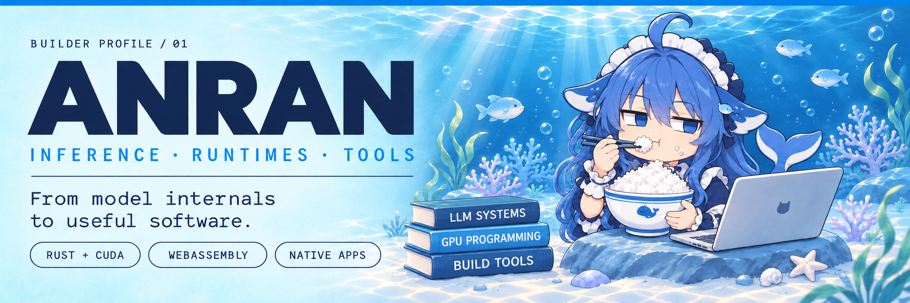

  

Hi, I'm **Anran**. I work on LLM inference and AI infrastructure, and I learn by building things from scratch, running them, and measuring the results.

**Blog:** [anrans.github.io](https://anrans.github.io/) — notes on inference systems, GPU programming, and AI infra.

### LLM inference

- [**nano-vllm-rs**](https://github.com/AnranS/nano-vllm-rs) — Single-GPU Qwen3 inference in Rust + CUDA, with reproducible benchmarks.
- [**mini-sglang-mlx**](https://github.com/AnranS/mini-sglang-mlx) — mini-sglang rebuilt on Apple Silicon with MLX: paged KV, radix cache, Metal attention.
- [**sglang-interactive-guide**](https://github.com/AnranS/sglang-interactive-guide) — An interactive SGLang guide in Chinese that runs offline and needs no GPU.

### Mini-game tooling

- [**godot_for_minigame**](https://github.com/AnranS/godot_for_minigame) — Export Godot 4 games to WeChat and Douyin mini games.
- [**construct3-minigame-adapter**](https://github.com/AnranS/construct3-minigame-adapter) · [**defold_for_minigame**](https://github.com/AnranS/defold_for_minigame) · [**tiktok-minigame-unity-demo**](https://github.com/AnranS/tiktok-minigame-unity-demo)

### Other tools

- [**wasm-split-tool**](https://github.com/AnranS/wasm-split-tool) — Split a large `.wasm` file into an eager module and a lazy-loaded module.
- [**DesktopPulse**](https://github.com/AnranS/DesktopPulse) — Native macOS widgets for system stats and AI-tool usage.
- [**inline-vocab-translator**](https://github.com/AnranS/inline-vocab-translator) — Translate selected text inline while you read.

Rust · CUDA · Python · TypeScript · Swift
